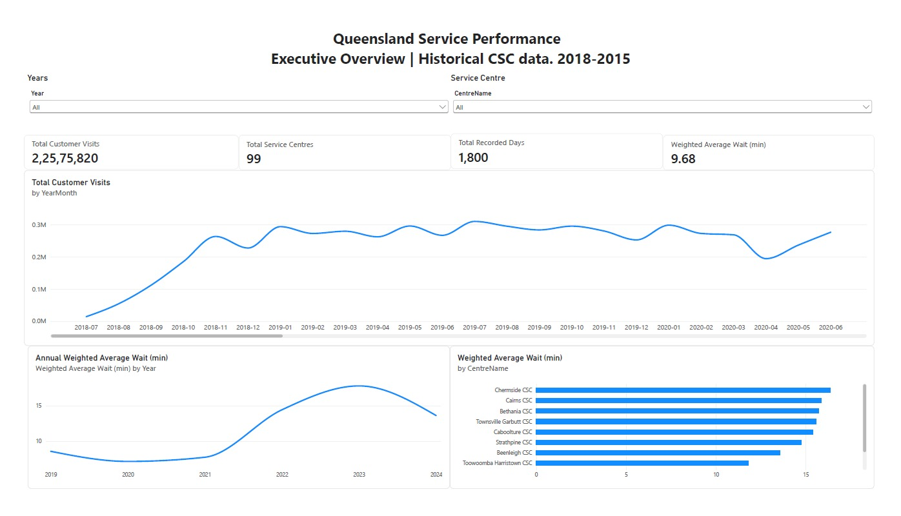
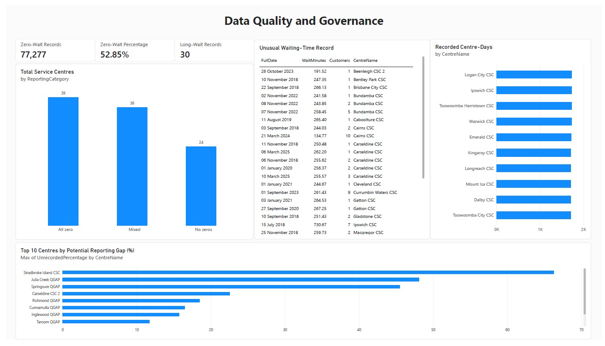
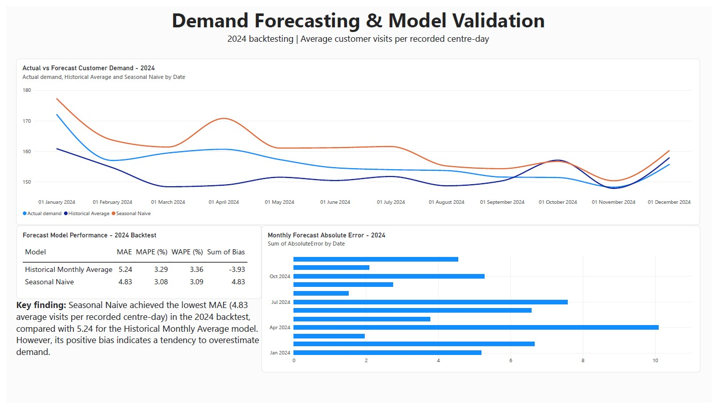

# Queensland Service Performance Intelligence

### SQL | Python | Power BI | Data Quality | Demand Forecasting

## Project Overview

This project analyses historical Queensland Government Customer Service Centre (CSC) waiting-time and customer-volume data from July 2018 to June 2025.

The objective is to transform publicly available operational data into actionable business insights through data cleaning, relational database modelling, SQL analysis, interactive Power BI reporting, data-quality assessment and demand forecasting.

The project demonstrates an end-to-end analytics workflow, from raw government data to business intelligence dashboards and model validation.

## Key Project Metrics

- **22,575,820** recorded customer visits
- **99** service centres
- **146,219** centre-day records
- **1,800** distinct reporting dates
- **9.68 minutes** estimated customer-weighted average wait
- **77,277** records reporting zero average wait
- **30** records reporting waits longer than two hours

The weighted waiting-time estimate includes zero-wait records. These records are retained because zero values cannot automatically be classified as missing or erroneous.

## Technologies Used

- **Python:** Pandas, data cleaning, exploratory analysis and forecasting
- **SQL / SQLite:** Relational database design, joins, aggregation and analytical queries
- **Power BI:** Data modelling, DAX measures, interactive dashboards and visualisation
- **Power Query:** Data preparation and type validation
- **VS Code / Jupyter Notebook:** Development and analysis


## Business Questions

This project addresses seven operational and analytical questions:

1. **Customer Demand:** How many customer visits were recorded across Queensland service centres?
2. **Waiting-Time Performance:** How long do customers wait, based on customer-weighted average waiting times?
3. **Centre Performance:** Which service centres experience higher average waiting times?
4. **Demand Patterns:** Which days and months experience higher customer demand?
5. **Historical Trends:** Are waiting times improving or deteriorating over time?
6. **Data Quality:** Are there unusual waiting-time records, reporting gaps or inconsistent reporting patterns?
7. **Demand Forecasting:** Can historical customer-volume patterns help estimate future demand?

The analysis uses SQL queries, Python transformations, Power BI measures and historical forecast backtesting to investigate these questions.

## Power BI Dashboard

The Power BI report contains three interactive pages covering operational performance, data quality and demand forecasting.

### 1. Executive Overview

Provides an overview of customer visits, service-centre coverage, waiting-time trends and centre-level comparisons.



### 2. Data Quality & Governance

Examines zero-wait reporting patterns, unusual waiting-time records and potential reporting gaps across service centres.



### 3. Demand Forecasting & Model Validation

Compares actual 2024 customer demand against two forecasting baselines and evaluates their prediction errors.



**Note:** The forecasting analysis uses a historical 2024 backtest. Forecast values represent average customer visits per recorded centre-day, not total monthly visits.


## Data Architecture & Methodology

### Data Source

The project uses the publicly available Queensland Government Customer Service Centre Wait Times dataset.

Source: https://www.data.qld.gov.au/dataset/customer-service-centre-wait-times

The dataset contains historical customer volumes and average waiting times reported by individual service centres.

### Data Processing Pipeline

Raw CSV Data
    |
    v
Python (Pandas)
- Data profiling and validation
- Date and waiting-time conversion
- Duplicate and missing-value checks
- Zero-wait and long-wait flags
    |
    v
SQLite Database
- DimDate
- DimCentre
- FactServicePerformance
    |
    v
SQL Business Analysis
- Customer demand
- Waiting-time performance
- Centre comparisons
- Reporting gaps
    |
    v
Power BI
- Star-schema relationships
- DAX measures
- Interactive reporting
- Data-quality dashboards
    |
    v
Business Insights & Forecast Validation

### Relational Data Model

The SQLite database follows a star-schema design with two dimension tables and one fact table.

**DimDate**
- DateKey (Primary Key)
- FullDate
- Year
- Month
- DayOfWeek

**DimCentre**
- CentreKey (Primary Key)
- CentreName
- ReportingCategory

**FactServicePerformance**
- PerformanceID (Primary Key)
- DateKey (Foreign Key)
- CentreKey (Foreign Key)
- Customers
- WaitMinutes
- ZeroWaitFlag
- LongWaitFlag

### Database Relationships

- DimDate (1) → (*) FactServicePerformance
- DimCentre (1) → (*) FactServicePerformance

The model supports date-based analysis, centre-level comparisons and reusable reporting measures.

### Data Quality Approach

The analysis preserves the original observations while identifying potential data-quality concerns.

Key checks include:

- Missing and duplicate records
- Invalid dates and waiting-time formats
- Negative customer counts
- Zero-wait reporting patterns
- Waiting-time records exceeding two hours
- Potential gaps in weekday reporting

Zero-wait values are not automatically treated as errors. Similarly, unrecorded weekdays are considered potential reporting gaps rather than confirmed missing data.


## Key Business Insights

### 1. Customer Demand and Service Centre Coverage

The dataset contains 22,575,820 recorded customer visits across 99 Queensland Customer Service Centres, representing 146,219 centre-day observations.

The five centres with the highest total recorded visits were:

| Service Centre | Recorded Customer Visits |
|---|---:|
| Logan City CSC | 969,219 |
| Macgregor CSC | 774,673 |
| Helensvale CSC | 721,566 |
| Greenslopes CSC | 625,796 |
| Chermside CSC | 610,838 |

These totals reflect the available historical reporting records. Differences in reporting coverage mean they should not be interpreted as a like-for-like measure of centre efficiency.

### 2. Customer Waiting-Time Performance

The estimated customer-weighted average waiting time was 9.68 minutes across all records.

When centre-day records reporting zero average wait were excluded, the estimated weighted average increased to 11.46 minutes.

This difference demonstrates the importance of investigating zero-wait reporting patterns before interpreting service performance.

Both figures are analytical estimates calculated using recorded customer volumes and centre-day average waiting times.

### 3. Historical Waiting-Time Trends

An analysis of 19 service centres represented in every year from 2019 to 2024 identified the following customer-weighted waiting times:

| Year | Average Wait (Minutes) |
|---|---:|
| 2019 | 8.44 |
| 2020 | 7.05 |
| 2021 | 7.58 |
| 2022 | 14.04 |
| 2023 | 17.85 |
| 2024 | 14.09 |

Waiting times increased substantially during 2022–2023 before declining in 2024.

Although 2024 showed an improvement compared with 2023, the estimated average remained higher than in 2019.

The analysis uses a consistent 19-centre cohort, but reporting frequency within that cohort may still vary.

### 4. Data Quality and Reporting Patterns

The analysis identified several reporting characteristics requiring careful interpretation:

- 77,277 centre-day records (52.85%) reported zero average waiting time.
- 39 centres reported zero average waiting time across all their available records.
- 36 centres contained a mixture of zero and positive waiting-time records.
- 24 centres reported no zero average waiting-time records.
- 30 records exceeded the 120-minute investigation threshold.

Potential weekday reporting gaps were also identified by comparing recorded weekdays with weekdays within each centre's observed reporting period.

These findings highlight the importance of data validation, reporting coverage and transparent analytical assumptions.

Zero-wait records and unrecorded weekdays are not automatically classified as errors.

## Demand Forecasting & Model Validation

### Forecasting Objective

Evaluate whether historical customer-volume patterns can provide useful baseline estimates of demand.

The forecasting target was average customer visits per recorded centre-day, rather than total monthly visits, to reduce the influence of changing reporting coverage.

### Forecasting Methodology

- Training period: January 2019 to December 2023
- Testing period: January 2024 to December 2024
- Forecast frequency: Monthly
- Validation approach: Historical holdout backtesting

Two baseline models were evaluated:

1. **Seasonal Naive:** Uses the corresponding month's value from the previous year.
2. **Historical Monthly Average:** Uses the historical average for the corresponding calendar month during the training period.

### Model Performance

| Evaluation Metric | Seasonal Naive | Historical Monthly Average |
|---|---:|---:|
| MAE | 4.83 | 5.24 |
| MAPE | 3.08% | 3.29% |
| WAPE | 3.09% | 3.36% |
| Bias | +4.83 | -3.93 |

### Forecasting Findings

The Seasonal Naive model achieved the lowest Mean Absolute Error (MAE), at 4.83 average visits per recorded centre-day.

This represents approximately 7.8% lower MAE than the Historical Monthly Average baseline.

However, the Seasonal Naive model showed a positive bias, indicating systematic overprediction during the 2024 evaluation period.

The results demonstrate the value of comparing multiple forecasting baselines and evaluating both accuracy and directional bias.

### Forecasting Limitations

- The evaluation covers only one 12-month holdout period.
- Changes in service-centre reporting coverage may affect demand estimates.
- Forecasts do not account for holidays, staffing, policy changes or external demand drivers.
- The analysis is a historical backtest, not a live 2026 demand forecast.
- Additional validation would be required before operational deployment.


## Project Structure

```text
QLD-Service-Performance-Intelligence/
│
├── data/
│   ├── raw/
│   │   └── csc_wait_times_2025_06_11_1155.csv
│   └── processed/
│       ├── csc_wait_times_analysis_ready.csv
│       ├── service_performance.db
│       ├── forecast_2024_validation.csv
│       ├── forecast_model_comparison.csv
│       └── powerbi_exports/
│
├── notebooks/
│   ├── 01_data_profiling.ipynb
│   ├── 02_build_database.ipynb
│   └── 03_demand_forecasting.ipynb
│
├── sql/
│   └── SQL scripts for database creation and business analysis
│
├── powerbi/
│   ├── QLD_Service_Performance_Intelligence.pbix
│   └── Screenshot/
│       ├── 01_executive_overview.jpg
│       ├── 02_data_quality.jpg
│       └── 03_demand_forecasting.jpg
│
├── documentation/
│   └── data_dictionary.md
│
└── README.md
```

## How to Reproduce the Analysis

### Requirements

- Python 3
- Jupyter Notebook
- Pandas
- SQLite
- Power BI Desktop (Windows)

### Recommended Workflow

1. Download the historical Customer Service Centre Wait Times dataset from the Queensland Government Open Data Portal.
2. Place the source CSV in `data/raw/`.
3. Run `01_data_profiling.ipynb` to inspect and clean the data.
4. Run `02_build_database.ipynb` to create the SQLite database and reporting exports.
5. Run `03_demand_forecasting.ipynb` to evaluate the forecasting baselines.
6. Review the SQL scripts for database modelling and operational analysis.
7. Open the Power BI report in Power BI Desktop and configure the local data-source paths if required.

The notebooks should be executed in the order listed above. Local file paths may need adjustment depending on the environment.

## Project Limitations

- The source is a historical dataset ending in June 2025, not a live operational feed.
- Reporting coverage varies across service centres and dates.
- Zero-wait records are retained, but their underlying reporting meaning cannot be independently verified.
- Estimated customer-weighted waiting times rely on the recorded customer counts and centre-day averages.
- Potential weekday reporting gaps do not account for public holidays or centre-specific operating schedules.
- The forecasting models are historical baselines, not production-ready predictions.
- Findings should not be interpreted as current Queensland Government service performance.

## Data Attribution

**Source:** Queensland Government Open Data Portal

**Dataset:** Customer Service Centre Wait Times

https://www.data.qld.gov.au/dataset/customer-service-centre-wait-times/resource/421312d3-dcc7-4d20-aa01-46acea49c347

This is an independent portfolio project using publicly available government data. It is not an official Queensland Government performance report.
